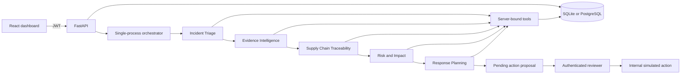

# Architecture and trust boundaries

## Request and investigation lifecycle

The five roles are application agents, not coding subagents. In Demo Mode they execute prescribed tool workflows and transparent deterministic summaries. In live mode each stage selects tools in a bounded Responses API loop. Structured validated results are passed to the next agent. Run progress is observable through database events and polling; no invented typing animation represents live reasoning.

## Relational records

The 20 domain tables are organizations, users, suppliers, material_lots, production_batches, batch_material_usage, inspections, shipments, shipment_items, customers, incidents, investigations, evidence_documents, evidence_findings, agent_runs, agent_tool_calls, investigation_events, action_proposals, approvals and audit_logs.

Organization ownership is indexed on tenant tables. Trace edges have real foreign keys and unique batch/lot or shipment/batch pairs. Quantities have positivity checks for usage/items and nonnegative checks for material stock. The incident-to-investigation uniqueness constraint prevents duplicate investigations for concurrent starts. SQLite foreign keys are enabled explicitly.

API reads and tool queries always include organization scope. Referenced incident/lot/batch/document/proposal IDs are resolved with that scope. An ORM before-flush guard prevents creating cross-organization foreign-key links or reassigning a row's tenant. PostgreSQL database-level composite tenant keys or RLS would further defend against direct SQL access and are a pilot-hardening requirement.

## Sensitive operations

Models receive no approval, direct SQL, outbound network, email, filesystem-execution or external inventory tools. Final containment drafts use SQL-derived target IDs. Human-written drafts also inherit the investigation's validated targets and edge references. Approval requires a current admin or reviewer role, an authenticated organization, a pending state and a justification. A conditional status update guards duplicate decisions; PostgreSQL also locks the proposal row. Prior approvals remain append-only application history when a revision is resubmitted.

Only inventory hold/release approvals modify simulated batch status. Releases require explicit reviewer source-verification attestation and cannot overlap unresolved pending hold proposals. Customer notifications, supplier escalations and corrective assignments persist as internal approval records. These records do not imply that a customer was contacted or a physical inventory action occurred. Explicit authenticated manufacturing entry can reserve lot quantities and create shipments; it is not exposed as an AI tool.

## Documents and uncertainty

Uploads are bounded to 10 MB, UUID-named outside the frontend public directory, and restricted to text PDFs or UTF-8 CSVs. PDFs have a page bound and magic-signature check. CSV extraction checks missing values, column shape and contradictory claims; investigation evidence analysis also checks unknown batch/lot codes and discrepancies with validated inspection results. Source hashes and original files are retained. Uploads are evidence, not automatic authorized imports.

Agent prompts explicitly mark all source and incident content as untrusted. Tool arguments are validated and reject extra fields; organization and incident IDs cannot be changed by the model. Reference validation checks existence and relevance, not whether every natural-language assertion is entailed by a source. Human verification remains necessary. Potentially exposed units are computed from shipment item quantities; they are not confirmed defects, financial losses, or unique exposure across multiple overlapping investigations.

## Production pilot work

Implemented baseline controls now include HttpOnly/SameSite cookies, Secure cookies in production, CSRF/Origin checks, session revocation, local login throttling, bounded request parsing, production secret validation and Supabase browser-role RLS isolation. A pilot still needs shared throttling, account recovery/MFA, durable queue workers, encrypted object storage, antivirus/PDF extraction isolation, backup automation, monitoring, deeper database tenant policies and provider-policy reviews. The initial migration is frozen and subsequent schema changes use explicit revisions. Add an industry-specific validated risk model before estimating financial impact. A pilot needs a security review and business ownership of approval policy. No live credentials or external operational connections were used in development.
